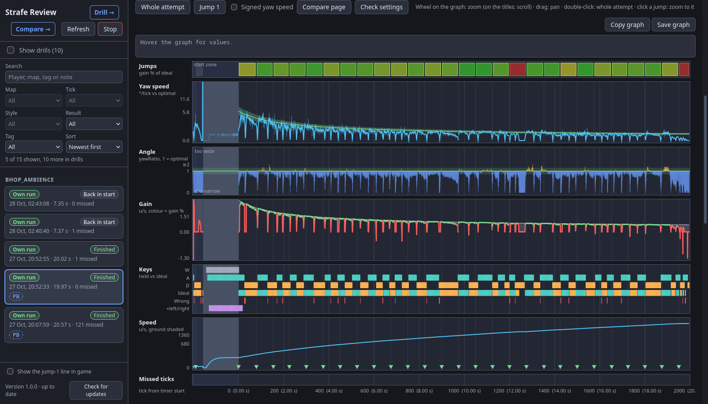

# Strafe Review

Per-tick strafe recording and review for [Momentum Mod](https://momentum-mod.org/). A small HUD script records every attempt, and a page in your browser shows each jump as a graph, lists the mistakes it finds, and compares your strafing with optimal movement and with replays.

The review page has three parts:

- `/`: one attempt as a zoomable graph, with run stats (including CS:S-style SSJ gain), the mistakes found and a top-down path. Attempts take notes and tags; automatic tags mark PBs and sens changes. The list filters by map, tickrate, style, result and tag, has a search box, and sorts by date, fastest finish, jump 1 speed or player. "Compare page" opens it on /compare.
- `/drill`: jump 1 of every attempt, stacked and side by side, updated live, with each strafe's mouse movement in cm next to the optimal (type your mouse DPI in once).
- `/compare`: 2 to 4 recordings on one graph, with every run stat side by side (best per row marked), per jump numbers, mistakes and paths. The picker has the same search and sort. Quick picks: your fastest finish, your best jump 1, top replay.

In game, the recorder can show a 3-row line after jump 1 lands: landing speed, gain % per strafe and the biggest mistake (off by default, see below).

Replays played to the end count as finishes (see [Replays](#replays)). Bonus tracks are recorded and listed per bonus ("surf_artois: b1"), and 66-tick bhop works next to 66-tick surf.

Run stats, graphs and paths on `/` and `/compare` each have Copy and Save buttons: Copy puts a picture of that section on the clipboard, Save downloads it as a PNG.

Everything stays on your PC: the page runs at http://127.0.0.1:8765/ and the only thing it asks the internet for is whether a new release is out.

## Replays

Play any replay in Momentum (your own or someone else's) and it is recorded like a run. A replay doesn't carry the game's per-tick gain stats, so gain and angle are worked out from speed; on your own run and its replay they come out the same.

- **Missed ticks are filled from the replay.** The recorder reads the game once per frame, so a frame that takes longer than a tick loses that tick. When a replay sits paused at its end (where it stops by itself), the recorder steps the paused replay back to each tick it missed, reads it, and returns to the end. The view jumps around for a moment, then a note at the top of the screen says the replay was saved and how many missed ticks were filled. Leave the replay paused at the end until the note shows; a replay you leave earlier keeps its missed ticks. This is the only time it controls the game, and only the replay's playback.
- **View angles.** A replay plays its view angles back about 60 ms late (its speed and keys are on time), and the page moves them back. On every tick with a strafe key held, the yaw is taken from the game's own wish velocity, which gives the exact angle the movement used, on live runs as well as replays. The few ticks around a key switch with both or no strafe keys held keep the measured yaw.

## What changed in 1.1.0

Version 1.1.0 changes how recordings are read, so numbers on attempts you already have shift a little when you open them again:

- Yaw speed, Angle and everything worked out from them (strafes, reversals, key timing, mistakes) now use the exact yaw from the wish velocity instead of the per-frame sample. Single-tick spikes in yaw speed get smaller, and some mistakes may appear or go away.
- Replays get the key timing checks, sync and key lag like your own runs (before, their keys were thought to run ahead of the turn; it is the view angles that run late).
- Replays recorded from now on have their missed ticks filled (above). Older replay recordings keep theirs; play the replay to the end once more to record it again.
- Small fixes: switching between a run and a replay no longer moves the graph, the header stays on one row, and graph scales no longer depend on missed ticks.

## Requirements

- Momentum Mod from Steam (the Playtest build works; the game folder is found through Steam's library list).
- Windows 10 or 11 for the exe, or Linux with Python 3.10 or newer and a systemd user session for the launch wrapper.
- A browser.

## Install on Windows

1. Download `strafe-review-windows.zip` from the [latest release](https://github.com/Soulmanyes/strafe-review/releases/latest) and unzip it to a folder you keep (the Steam launch option points at it).
2. Double-click `strafe-review.exe`. Windows Defender or SmartScreen may warn, because the exe isn't signed. It finds Momentum, installs the recorder and the `autoexec.cfg` block (see below), then opens the review page. Keep its console window open while playing, or click **Stop** on the page to end it.
3. Restart Momentum once, so it reads the new `autoexec.cfg` lines.
4. Or let Steam start it with the game: Momentum Mod > Properties > Launch options: `"C:\path\to\strafe-review.exe" %command%`. It then runs in the background, opens the page as the game starts, and keeps running for review until you click **Stop**.

Attempts are kept in `%LOCALAPPDATA%\strafe-review\attempts`, and everything it prints also goes to `%LOCALAPPDATA%\strafe-review\strafe-review.log`. `WINDOWS.txt` in the zip has the same steps.

## Install on Linux

1. Clone this repo and keep it where it is; the launcher runs from it.
2. `python install.py` finds Momentum (or pass `--game DIR`, or set `MOMENTUM_DIR`), installs the recorder and the `autoexec.cfg` block, and links `strafe-review-run` into `~/.local/bin`.
3. Set Momentum Mod's Steam launch options to `strafe-review-run %command%` (it chains with other wrappers, e.g. `strafe-review-run sourceyaw-run %command%`). The game start then starts the server as the systemd user unit `strafe-review`, which keeps running after the game quits; the page opens as the game starts. **Stop** on the page or `systemctl --user stop strafe-review` ends it.
4. Restart Momentum once. Or start the server by hand: `python viewer/server.py` (`--port`, `--no-collect` to only serve, `--no-browser`).

Attempts are kept in `~/.local/share/strafe-review/attempts`.

## What it changes in the game folder

- `custom/0-strafe-review`: the recorder script, plus a `timer.xml` that loads it. That file is a copy of the one the game would use otherwise (another HUD mod's in `custom/`, or the game's own) with one line added, made again on every start so other mods' updates carry over. The folder name sorts first because the game mounts `custom/` folders alphabetically and the first file found wins.
- `cfg/autoexec.cfg`: a block between `// strafe-review begin` and `// strafe-review end` with `con_logfile yaw.log` (the console log the recorder writes to) and `engine_no_focus_sleep 0` (replays watched while tabbed out keep every tick). The first install keeps the original as `autoexec.cfg.bak-strafe-review`.

`python install.py --uninstall` (or deleting both by hand on Windows) takes them out again. If no attempts show up, the main page shows a **Setup check** box that says where it stops.

## Updates and settings

- The page checks GitHub for a new release every few hours and shows a banner when there is one. The Windows exe installs it with **Update** and starts again; tick **Install updates automatically** (bottom left of the main page) to skip the button. It never updates while a game is being played. A copy running from this repo only reports new versions: `git pull` brings them, then `python install.py` again when the recorder changed (it did in 1.1.0) and `panorama_reload` in the game console. The exe installs the recorder by itself at every start.
- **Show the jump-1 line in game** (bottom left of the main page) turns on the in-game line after jump 1. It is off by default so it doesn't land on top of anyone's own HUD. Type `panorama_reload` in the game console after changing it.

## Building the exe

`python build.py` (with `pip install pyinstaller`) builds `dist/strafe-review.exe` on Windows. `.github/workflows/windows.yml` does it on GitHub, runs `smoke_test.py` against the built exe and attaches the zip to a `v*` tag's release.

More plans: [PLAN.md](PLAN.md).

## Thanks

Thanks to Frank for testing the Windows version.

License: CC0 1.0 (see [LICENSE](LICENSE)). The Windows exe also bundles Python, OpenSSL and the PyInstaller bootloader under their own licences; see [THIRD-PARTY-NOTICES.txt](THIRD-PARTY-NOTICES.txt).
